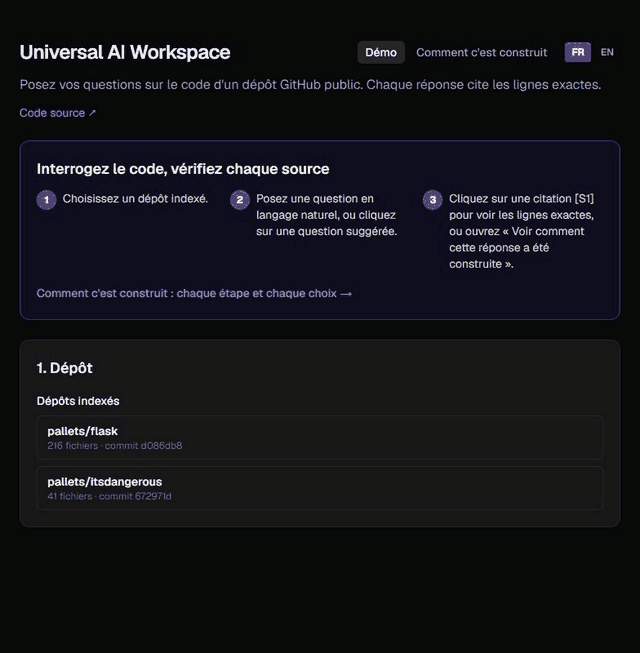
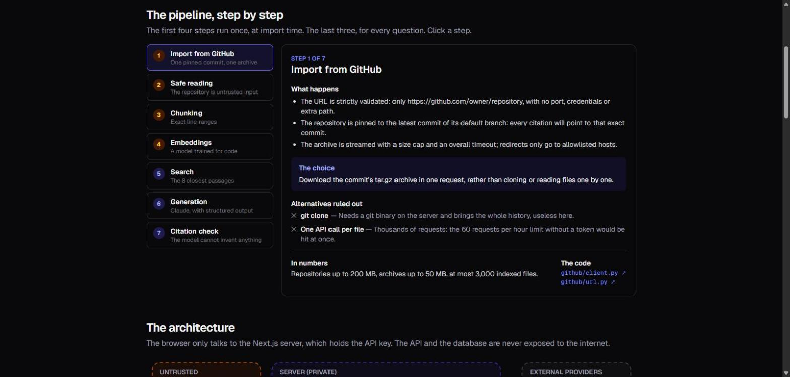
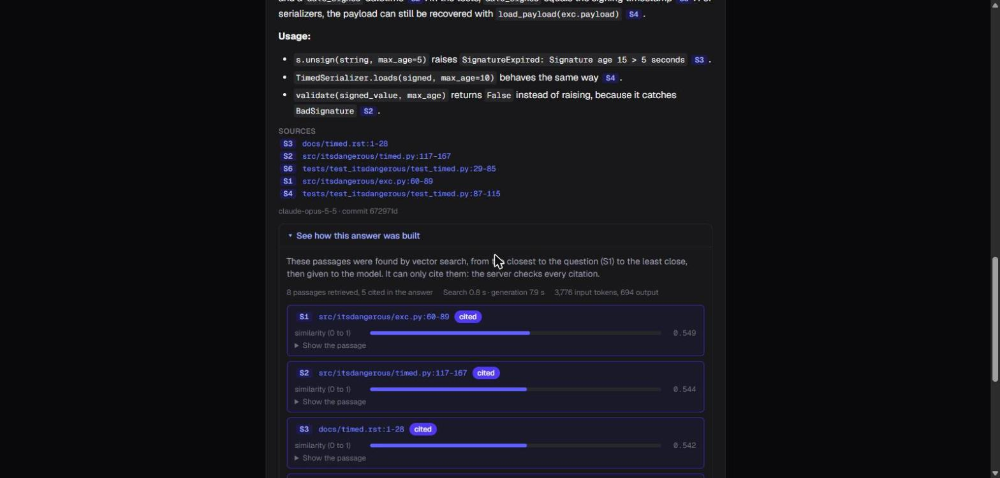
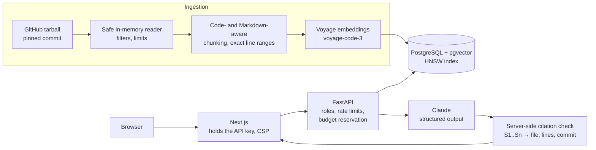

# Universal AI Workspace

**Ask questions about a GitHub repository's code. Get answers that cite the exact lines, and
citations the model cannot invent.**

[](https://github.com/AurelienB20/universal-ai-workspace/actions/workflows/ci.yml)


[](LICENSE)



Import a public repository, ask *"How are expired tokens detected?"*, and get a Markdown
answer where every `[S1]` links to the cited lines on GitHub, at the exact commit that was
indexed. Under each answer, *See how this answer was built* shows the evidence: every
passage given to the model, its similarity score, whether the answer cites it, and any
citation the server removed. A retrieval-augmented generation (RAG) system built end to
end, from a hardened GitHub connector to a public-demo-ready web interface, with the cost
and security controls a real deployment needs.

The app also has a **How it is built** page: each pipeline step, the choice made, the
alternatives ruled out, an architecture diagram with its trust zones, and eight
architecture decisions with their trade-offs, each linked to the code.

**Read more:** [case study](docs/case-study.md) (the problem, the decisions, what went
wrong and what changed) · [architecture decision records](docs/adr/README.md) ·
[technical details](docs/technical-details.md)

<p align="center">
  
  
</p>

## What makes it more than a RAG demo

Each point below is enforced by code and checked by a test, not just described.

| | Problem | How it is solved | Proof |
|---|---|---|---|
| 🔗 | **LLMs invent sources.** | Passages reach the model under opaque IDs (`S1`, `S2`…). The server maps each ID back to its file, lines and commit, and drops any ID that was not retrieved. An invented file name or line number cannot appear in a citation. | [`citations.py`](backend/src/uaw/generation/citations.py), [tests](backend/tests/unit/test_citations.py) |
| 💸 | **Budgets leak under concurrency.** Checking "spent < budget" lets 20 simultaneous questions all pass. | Each question reserves its worst-case tokens first, under a PostgreSQL advisory lock. The test sends 5 questions for a budget of 3: exactly 3 pass, and it fails if the lock is removed. | [`tracker.py`](backend/src/uaw/usage/tracker.py), [test](backend/tests/integration/test_usage.py) |
| 🛡️ | **Repositories are untrusted input**, for the server and for the model. | Archives are read in memory, never extracted: decompression bombs, path traversal and oversized files are rejected. Passages are escaped inside `<source>` tags, and opt-in tests run real prompt-injection attempts against the model. | [archive tests](backend/tests/unit/test_github_archive.py), [injection tests](backend/tests/live/test_prompt_injection_live.py) |
| 🔍 | **Filtered vector search silently returns nothing.** An HNSW index over every repository keeps the nearest chunks of the whole table, then the repository filter removes them all. | pgvector iterative index scans. An integration test forces the plan and shows the plain query losing every result. | [test](backend/tests/integration/test_search.py) |
| 🔐 | **A public demo is a cost and abuse target.** | Two roles: the demo key can only question an allowlist of repositories and never import. Rate limits, a cap on concurrent questions, required daily budgets. The API key never reaches the browser; a Content Security Policy guards the page. | [`security.py`](backend/src/uaw/api/security.py), [frontend](frontend/README.md) |
| ⚡ | **Live answers cost money and take ~10 s.** | Suggested questions are answered once and served from a cache, labelled with their generation date, and deleted with the snapshot they came from, so they never describe other code. | [test](backend/tests/integration/test_suggestions.py) |

## How it works



1. **Import.** The repository is fetched at a pinned commit, filtered (no dependencies,
   binaries, secrets or lockfiles) and split into chunks that keep exact line ranges and
   cut at definitions or Markdown headings. Each chunk is embedded; the snapshot becomes
   searchable only once every chunk has its vector.
2. **Ask.** The question is embedded, the nearest chunks of the latest snapshot are
   retrieved, and Claude answers from them only, through a JSON schema that also lets it
   say the context is insufficient instead of guessing.
3. **Cite.** The server resolves every `[Sn]` to a permanent GitHub link to the exact
   lines. Anything else is removed before the answer is returned.

## Measured, not assumed

On [pallets/itsdangerous](https://github.com/pallets/itsdangerous) (41 files, 99 passages):

| Metric | Value |
|---|---|
| Answer latency | ~10 s median, 7–12 s observed (Claude Opus 5.5, effort `medium`) |
| Tokens per question | 1.8k–5.8k in, 0.4k–0.9k out |
| Cost per question | ~$0.03 (every call is metered and stored) |
| Retrieval, 20 labeled questions | hit@1 1.00, recall@5 0.96, MRR 1.00 |

The retrieval scores are saturated: this question set is too easy to measure any
improvement. A harder evaluation comes first on the roadmap, before hybrid search or
reranking, so that each change is kept only if it measurably helps.

**Tests:** 460 backend tests (unit, and integration against a real PostgreSQL), 32 frontend
tests, strict typing (mypy, TypeScript), all run in CI along with both production Docker
image builds.

## Tech stack

| Layer | Choice |
|---|---|
| API | Python 3.12, FastAPI, SQLAlchemy 2 (async), Pydantic, uv |
| Storage | PostgreSQL 16 + pgvector (HNSW, cosine), Alembic migrations |
| Models | Voyage `voyage-code-3` (embeddings), Claude Opus 5.5 (answers, structured output) |
| Web | Next.js 16, React 19, TypeScript, Tailwind CSS 4; French and English |
| Quality | pytest, Vitest, mypy strict, ruff, ESLint, GitHub Actions |
| Delivery | Multi-stage, non-root Docker images; Docker Compose |

## Run it locally

Needs [uv](https://docs.astral.sh/uv/), Node.js 22, PostgreSQL 16 + pgvector (`docker compose
up -d --wait db`), and Voyage and Anthropic API keys.

```bash
cd backend && uv sync && cp .env.example .env   # then set VOYAGE_API_KEY, ANTHROPIC_API_KEY
uv run alembic upgrade head
uv run uvicorn uaw.main:create_app --factory    # http://127.0.0.1:8000/docs

cd ../frontend && npm install && cp .env.example .env.local
npm run dev                                     # http://localhost:3000
```

Setup without Docker, every API call, checks and deployment:
[docs/technical-details.md](docs/technical-details.md).

## Roadmap

- [x] **MVP:** GitHub connector, chunking, embeddings, vector search, cited answers, web
  interface.
- [x] **Safe public foundation:** demo and admin roles, atomic budgets, concurrency limit,
  snapshot cleanup, cached suggested answers, security headers.
- [x] **Showcase:** *Explain the Evidence* under every answer, a *How it is built* page,
  suggested questions.
- [ ] Public deployment (Docker Compose, Caddy, tested backups).
- [ ] Streaming answers (server-sent events).
- [ ] Harder evaluation set, then hybrid search (full text + vectors, RRF), then
  reranking, each kept only if measured better.
- [ ] More sources (PostgreSQL, PDF), multi-user workspaces.

## License

[MIT](LICENSE) © 2026 Aurélien Benoit
